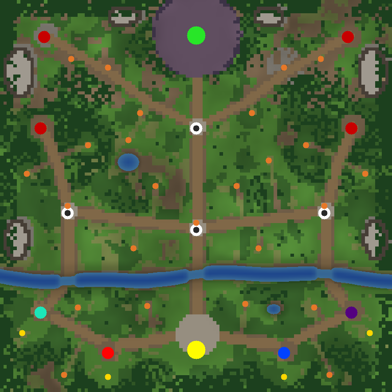
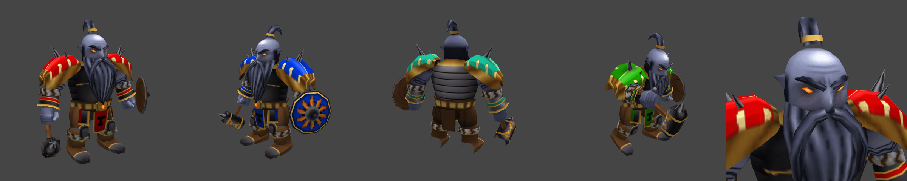

# Shadows over Brightwater

A Warcraft III custom map: a **co-op RPG with strategy elements** for 1–4 players.



**Download:** [`dist/ShadowsOverBrightwater.w3x`](dist/ShadowsOverBrightwater.w3x). Copy it into your
`Warcraft III/Maps` folder (Reforged: `Documents/Warcraft III/Maps`), then host it as a custom game.
It is saved in the classic Frozen Throne format, so it should load in 1.26 through current Reforged.

## The game

The Lich Kel'Thuzad has raised a Black Citadel in the blighted north. Brightwater, the last free town
of the vale, needs heroes and commanders.

**RPG**
- Pick one of ten heroes when the game starts (the map's own Dark Iron Thane, or one of the nine
  classic heroes), or choose *Random* for +150 gold. If you don't pick within 45 seconds, you get a
  random hero.
- Level up on 25 creep camps that get tougher the further north you go. Camps drop random items, and all but
  the outpost guards respawn about 3½ minutes after they are cleared. Heroes at level 5 and above still earn experience
  from creeps (normally they stop at level 5).
- Side quests in the quest log (F9):
  - *The Brood Mother* (west)
  - *The Stolen Urn*: kill the Bandit Lord, then bring the Urn back to the castle
  - *The Ogre Lord* (north-east)
  - *Wings of Flame*: the Red Dragon (north-west)
  - *Wolf Pelts*: slay 12 wolves
  - *Reclaim the Frontier*: hold all four outposts at once
- Fallen heroes come back at your town hall after 10 seconds plus 3 seconds per hero level.
- Shops in Brightwater:
  - the Goblin Merchant sells potions and scrolls
  - the Armory (a marketplace with fixed gear) sells claws, rings, stat items and greater potions
  - the Mercenary Camp hires troops
  - a Fountain of Health heals nearby units

**Strategy**
- Each player starts with a Human base: a Town Hall, 5 peasants, 2 footmen and a gold mine, with
  lumber groves nearby. The full Human tech tree is open except the Altar, since your one hero is
  your RPG character.
- **Outposts:**
  - Crossroads, Westwatch and Eastmarch start out guarded by creeps.
  - Northgate starts held by the Scourge.
  - To claim one, clear its guards, then bring a hero next to it. You get a Guard Tower there plus
    +15 gold and +5 lumber every 10 seconds.
- **Scourge raids** start at 6:00 and keep coming, every 85–150 seconds.
  - They target Brightwater Castle, your town halls and the outposts you hold.
  - Raids grow with time, player count and how many outposts the Scourge holds.
  - The Scourge gains new unit types and upgrades as the game goes on.
  - Raiders that find an outpost with nobody defending it capture it for the Scourge.
- A river crosses the vale. Ground armies can only cross at three fords, which makes natural choke
  points.

**Win:** slay Kel'Thuzad *and* destroy the Black Citadel. **Lose:** Brightwater Castle falls.
Type `-help` in game for a summary.

## The Dark Iron Thane



The map comes with its own hero, a Dark Iron dwarf with his own model, skin and icon, generated by
`mapgen/dwarf.py`. He is built like the classic units:
- around 2,300 triangles of angular planes on a full hero skeleton (shoulders, elbows, knees, feet)
- a 256×256 hand-painted-style skin with team colour on his pauldrons, gauntlets, tabard and shield
- 15 animations: stands, walk, two attacks, three spell casts, death, decay, victory and portrait

He uses the Mountain King's stats and abilities, renamed for the Dark Iron clan:
- *Molten Hammer* (Storm Bolt)
- *Fire Stomp* (Thunder Clap)
- *Searing Blows* (Bash)
- *Avatar of Flame* (Avatar)

The proportions and modelling style follow the "King" model by Tranquil (Hive Workshop), which is
in this repository as a reference (`King.zip`). None of its geometry is used.

## Building the map

The map is built from source by a standard-library-only Python 3 script:

```
python3 build.py            # writes dist/ShadowsOverBrightwater.w3x
python3 build.py --preview  # also renders docs/overview.png
```

| Path | What it is |
| --- | --- |
| `src/war3map.j` | The game script (JASS), written by hand |
| `mapgen/layout.py` | Where everything goes: bases, town, outposts, roads, river, forests, camps, bosses |
| `mapgen/terrain.py` | Generates terrain heights, textures, water, cliffs, blight, pathing, trees, doodads and the minimap |
| `mapgen/script.py` | Adds the layout data and the `config`/`main` functions to the script |
| `mapgen/formats.py` | Writes the map's binary files (`w3i`, `w3e`, `wpm`, `doo`, …) and the BLP minimap |
| `mapgen/dwarf.py` | The Dark Iron Thane: model geometry, skeleton, animations, painted skin and icon |
| `mapgen/lowpoly.py` | Low-poly modelling helpers (lofts through cross sections, smoothing groups) |
| `mapgen/mdx.py`, `mapgen/image.py` | MDX model writer; BLP texture and PNG writers |
| `mapgen/bake.py`, `mapgen/raster.py` | Shading baked into the skin; a software renderer for the icon |
| `mapgen/hero.py`, `mapgen/objects.py` | The hero's unit and ability data (`w3u`, `w3a`) and the import list (`imp`) |
| `mapgen/mpq.py` | MPQ archive writer and reader |
| `tools/jass_sim.py` | A JASS interpreter with a mock game world, used to test the script |

The map also contains `war3map.wtg`/`war3map.wct`, so it can be opened in the World Editor. The game
code lives in the custom script section and uses a `globals` block there, so World Editor needs
JassHelper/vJass enabled to save it (Reforged's editor ships with it). Most changes are easier to
make in the files above followed by a rebuild.

## How it was checked

Tested without the game client:

- **Game data:**
  - Every unit, item, ability, upgrade, tile, tree and doodad ID was checked against the 1.27 game
    data.
  - Each binary file's layout was compared against maps saved by Blizzard's World Editor.
- **Independent parser:** the built `.w3x` (MPQ, `w3i`, `w3e`, `doo`, `wpm`, `mmp`, `wct`, `w3u`,
  `w3a`, `imp`, BLP, MDX) reads back cleanly in an independent parser (mdx-m3-viewer).
- **Hero model:** rendered with mdx-m3-viewer's WebGL renderer (the preview above) in every
  animation and several team colours.
- **Syntax:** the script passes [pjass](https://github.com/lep/pjass) against both the 1.27 and the
  current `common.j`/`Blizzard.j`.
- **Simulated playthroughs:** `tools/jass_sim.py` runs Blizzard's real `Blizzard.j` plus the map
  script through three scenarios and found no runtime errors (uninitialised variables, division by
  zero, op limit, bad `ExecuteFunc`):
  - a two-player game that picks heroes, clears camps, captures outposts, kills every boss, returns
    the Urn, survives ten raids and wins
  - a 45-minute four-player game with nobody fighting back
  - a defeat
- **Not yet done:** none of this replaces a real playtest, and the map has not been run in the
  actual game yet. Balance numbers (raid sizes, income, boss stats) are first guesses.

Tests:

```
python3 -m unittest discover -s tests
```

The pjass and simulator tests run when you point them at Blizzard's script headers (extract
`Scripts\common.j` and `Scripts\Blizzard.j` from your game):

```
WC3_COMMON_J=path/common.j WC3_BLIZZARD_J=path/Blizzard.j PJASS=path/pjass \
    python3 -m unittest discover -s tests
```
